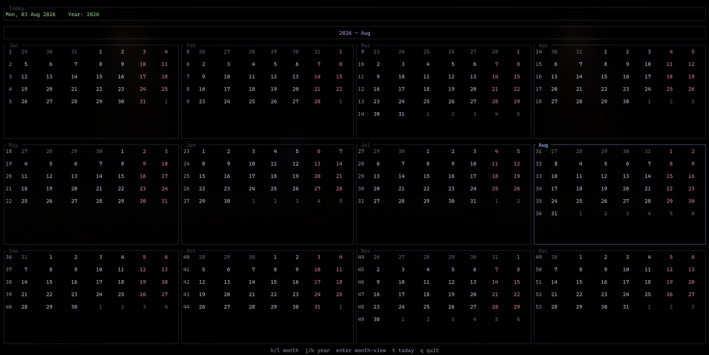

# calendar-tui

A minimal, fast **terminal calendar** built with [ratatui](https://crates.io/crates/ratatui)



## Keybindings

Global:

| Key      | Action                              |
| -------- | ----------------------------------- |
| `q`      | Quit                                |
| `Ctrl+c` | Quit                                |
| `m`      | Month view                          |
| `y`      | Year view                           |
| `Esc`    | Back to year view (from month view) |

**Month view** (navigation):

| Key               | Action                    |
| ----------------- | ------------------------- |
| `Left` / `h`      | Previous month            |
| `Right` / `l`     | Next month                |
| `Up` / `k`        | Previous year             |
| `Down` / `j`      | Next year                 |
| `PgUp` / `PgDn`   | Previous / next month     |
| `Home` / `t`      | Jump view to today        |
| `Enter` / `Space` | Toggle day selection mode |

**Month view** (selection mode, after `Space`):

| Key                                         | Action               |
| ------------------------------------------- | -------------------- |
| `Left` / `Right` / `h` / `l`                | Previous / next day  |
| `Up` / `Down` / `k` / `j` / `PgUp` / `PgDn` | Previous / next week |
| `Space` / `Enter`                           | Exit selection mode  |
| `Home` / `t`                                | Jump to today        |

**Year view**:

| Key             | Action                          |
| --------------- | ------------------------------- |
| `Left` / `h`    | Focus previous month            |
| `Right` / `l`   | Focus next month                |
| `Up` / `k`      | Previous year                   |
| `Down` / `j`    | Next year                       |
| `PgUp` / `PgDn` | Previous / next year            |
| `Home` / `t`    | Jump to today                   |
| `Enter`         | Open focused month (month view) |

A help line at the bottom of the screen summarizes bindings for the current mode.

## Configuration

Everything is optional: with no files, `calendar-tui` starts with the defaults below.

| File   | Default location                                                                                 |
| ------ | ------------------------------------------------------------------------------------------------ |
| Config | `$XDG_CONFIG_HOME/calendar-tui/config.toml` (falls back to `~/.config/calendar-tui/config.toml`) |
| Theme  | named by `[calendar].theme` in the config (default `theme.toml`), see below                     |

A missing file at the default location means the defaults. A file you name (with
`--config`, `--theme`, or the config's `theme` key) must exist. Unknown keys are errors that
name the key, so a typo doesn't silently keep the default.

### config.toml

[`examples/config.toml`](examples/config.toml) lists every key with its default:

| Key                          | Default          | Meaning                                                      |
| ---------------------------- | ---------------- | ------------------------------------------------------------ |
| `[calendar] week_start`      | `"monday"`       | First column: `monday` … `sunday`                            |
| `[calendar] show_week_numbers` | `false`        | ISO week number column, in both views where there's room     |
| `[calendar] theme`           | `"theme.toml"`   | Theme file name or path (see below)                          |
| `[display] default_mode`     | `"year"`         | View at start: `year` or `month`                             |
| `[display] date_format`      | `"%a, %d %b %Y"` | Today in the status line ([strftime][strftime] directives)   |
| `[display] month_year_format`| `"%B %Y"`        | Month view header                                            |

An unknown `%` directive is printed as written.

[strftime]: https://docs.rs/jiff/latest/jiff/fmt/strtime/index.html

### Themes

A relative `theme` is looked up next to the config file, then in a `themes/` directory next
to it, then in `$XDG_CONFIG_HOME/calendar-tui/themes/`. `--theme PATH` overrides it.

[`examples/theme.toml`](examples/theme.toml) shows every color. Colors are `#RRGGBB` or
`#RRGGBBAA`; an alpha of `00` leaves that layer to the terminal (a transparent background),
any other alpha is opaque.

| Section      | Keys                                                                 |
| ------------ | -------------------------------------------------------------------- |
| `[base]`     | `background`, `foreground`, `border`                                 |
| `[calendar]` | `header`, `status`, `today`, `selected`, `weekend`, `other_month`    |

## Command line

```text
calendar-tui [--config FILE] [--theme FILE]
```

| Exit code | Meaning                                                   |
| --------- | --------------------------------------------------------- |
| 0         | Quit normally                                             |
| 1         | A config or theme file is missing, unreadable or invalid  |
| 2         | Standard output isn't a terminal, or a bad command line   |

Errors and warnings go to stderr. `RUST_LOG=debug calendar-tui 2>log` shows more.

The year view fits itself to the terminal: four months a row from 106 columns (94 without
week numbers), three below that, and fewer decorations on short terminals. It needs at least 92x23; below that it
says so, and `m` shows the month view, which fits much smaller terminals.
